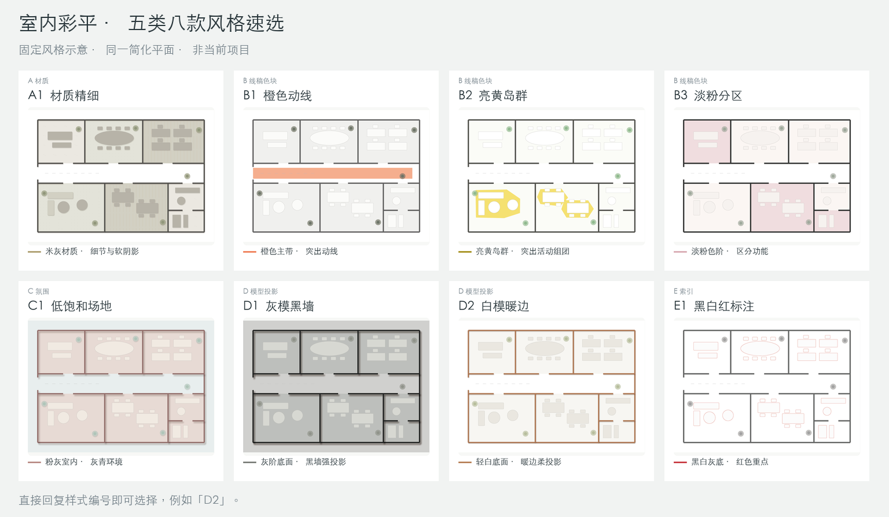

# 室内彩平制作 · InDesign

版本 **2.1.0**。收到平面 PDF 后，先展示预存的五类八款风格简图；用户选定样式号后，直接制作这一款 A3 彩平，图内编号与右侧功能名称逐项对应。

**上传 PDF → 预存图选样 → 用户选择一次 → 单款 InDesign 制作与交付。**

选样前不完整读取/OCR PDF、不描图、不启动 InDesign，也不为新项目先做四款小样。已经指定样式时直接沿用。只有用户明确要求当前 PDF 的多款对比，才执行该例外。



公开包仅包含自制示意图、通用模板和制作方法，不含真实客户案例或项目图纸。

## 下载与安装

源码目录：[skills/interior-colored-plan-indesign](https://github.com/maicrobin1988-prog/TJ-text/tree/main/skills/interior-colored-plan-indesign)。同事优先下载 [v2.1.0 Release](https://github.com/maicrobin1988-prog/TJ-text/releases/tag/interior-colored-plan-indesign-v2.1.0) 中对应工具的包，不要把整个仓库的源码 ZIP 当作单个技能上传。

| 工具/用途 | 下载包 | 包内结构 |
|---|---|---|
| WorkBuddy 桌面上传 | [interior-colored-plan-indesign-workbuddy.zip](https://github.com/maicrobin1988-prog/TJ-text/releases/download/interior-colored-plan-indesign-v2.1.0/interior-colored-plan-indesign-workbuddy.zip) | ZIP 根目录直接有 `SKILL.md`、`assets/`、`scripts/`、`references/` |
| 手工复制到技能目录 | [interior-colored-plan-indesign-portable.zip](https://github.com/maicrobin1988-prog/TJ-text/releases/download/interior-colored-plan-indesign-v2.1.0/interior-colored-plan-indesign-portable.zip) | ZIP 内只有一个 `interior-colored-plan-indesign/` 技能父目录 |

### WorkBuddy 桌面

1. 下载上面的 **workbuddy.zip**，保持 ZIP 格式。
2. 打开 **专家·技能·连接器 → 技能 → 添加技能 → 上传技能**，选择该文件，按客户端提示完成导入并启用。
3. 新开任务，上传 PDF，使用下文的调用话术。

这是官方支持的本地技能包导入入口。WorkBuddy 的“对话安装”只搜索技能市场，不能据此承诺把任意 GitHub URL 粘贴到聊天就会安装。[WorkBuddy 官方技能说明](https://www.codebuddy.cn/docs/workbuddy/From-Beginner-to-Expert-Guide/Function-Description/Skills-Market)

本地 ZIP 导入与开放平台市场上架是两件事。开放平台另有中英文展示名称、介绍、版本、作者等元数据要求；该规范不等于桌面本地上传的必填字段已获确认。这里提供专用上传包，但未提交市场上架，也不依赖宿主原生识别某个额外 manifest。[WorkBuddy 开放平台规范](https://open.workbuddy.cn/docs/skill)

### WorkBuddy 开发工作区 / CodeBuddy

解压 **portable.zip**，把整个技能目录放入项目下，形成：

```text
项目目录/
└── .codebuddy/
    └── skills/
        └── interior-colored-plan-indesign/
            ├── SKILL.md
            ├── assets/
            ├── scripts/
            └── references/
```

WorkBuddy 官方确认开发工作区支持 `.codebuddy/skills/`。CodeBuddy CLI 还支持用户级 `~/.codebuddy/skills/`，适合跨项目复用；不要同时放置多份同名副本。[WorkBuddy 项目配置](https://www.codebuddy.cn/docs/workbuddy/From-Beginner-to-Expert-Guide/Function-Description/Project)、[CodeBuddy Skills](https://www.codebuddy.cn/docs/cli/skills)

### Codex

在 Codex 中复制以下话术，按固定版本安装：

```text
请使用 $skill-installer 安装这个技能：
https://github.com/maicrobin1988-prog/TJ-text/tree/interior-colored-plan-indesign-v2.1.0/skills/interior-colored-plan-indesign
```

安装后下一轮对话可调用 `$interior-colored-plan-indesign`。也可解压 portable 包，将技能父目录复制到自己的 Codex skills 目录；自定义 `CODEX_HOME` 时使用实际配置位置。[Codex 官方 Skill Installer](https://github.com/openai/skills/tree/main/skills/.system/skill-installer)

### 其他支持 SKILL.md 的工具

使用 portable 包，将完整技能目录放入该工具官方支持的 skills 目录，不只复制 `SKILL.md`。入口采用通用 YAML `name/description` 和 Markdown；脚本通过自身位置寻找资源，不依赖作者电脑路径。宿主仍需能够读取本地文件、运行 Python，正式制作还需调用本机 InDesign。

## 给同事的调用话术

安装后上传 PDF，并复制：

```text
使用“室内彩平制作”处理这份 PDF。
先显示预存的五类八款简图，等我回复样式号后，直接制作选定款的 A3 彩平。
保留原布局与家具，图内编号与右侧功能名称逐项对应。
```

可选样式：**A1 材质精细、B1 橙色动线、B2 亮黄岛群、B3 淡粉分区、C1 低饱和氛围、D1 灰模黑墙、D2 白模暖边、E1 黑白红标注**。

选择工具由宿主提供，不强制依赖 Codex 专用工具。宿主有可用的单选卡时使用它；没有时直接回复 `A1` 等编号。如果聊天不能内联显示本地 PNG，用宿主的附件、产物或图片预览打开预存图，再回复同样编号；不要重新生成图片。

## 环境与执行范围

- **选样**：直接查看包内 PNG 即可；选项辅助脚本仅用 Python 标准库。
- **正式制作**：Python **3.9+**、`PyMuPDF>=1.26.5,<2`、`Pillow>=11,<12`，以及本机可用的 Adobe InDesign 和中文字体。技能包不包含 InDesign 软件或字体授权。
- **macOS**：可通过 `osascript` 执行生成的 JSX。已有本机 InDesign 2025 的原生制作验证。
- **Windows**：生成 JSX 后，通过 InDesign 的脚本面板运行；**Windows 与 WorkBuddy 桌面端到端流程尚未实测**。包结构及脚本检查不等于实际宿主导入、排版、导出均已通过。

在本机 Python 环境安装制作依赖：

```bash
python3 -m pip install "PyMuPDF>=1.26.5,<2" "Pillow>=11,<12"
```

Windows 可将 `python3` 替换为 `py -3`。依赖检查和完整核图放在选定风格之后，不阻塞首轮展示预存图。

代理在选定后根据 PDF 编制真实作业数据，生成 `run.jsx`；格式见 [作业数据说明](references/job-format.md)。macOS 执行示例：

```bash
osascript -e 'tell application "Adobe InDesign 2025" to do script (POSIX file "/absolute/path/final_R01/run.jsx") language javascript'
```

应用名替换为本机实际版本。Windows 在 InDesign 打开 **窗口 → 实用程序 → 脚本**，通过脚本面板的“在资源管理器中显示”定位 Scripts Panel 文件夹，放入生成的 `run.jsx` 后双击运行。更换技能安装位置后重新生成 JSX。[Adobe 官方脚本面板说明](https://helpx.adobe.com/indesign/desktop/automation-and-scripting/document-automation/automate-workflows-with-scripts.html)

正式交付包含 INDD、IDML、A3 PDF、预览、功能编号清单与 `Links/`。地坪、标号和功能表原生可编辑；置入 PDF 的内部线条不会自动变为独立 InDesign 对象。

## 更新给同事

1. 在仓库 Releases 中查找 `interior-colored-plan-indesign-v*` 的新版本，下载与自己安装方式一致的包。
2. 先备份技能目录里的个人修改和模板。WorkBuddy 按客户端提示更新；若提示同名技能已存在，备份后卸载旧版再上传，避免保留多份同名技能。目录安装只替换这个技能文件夹，不替换整个 `.codebuddy` 或其他工具配置目录。
3. 新开对话，让工具读取实际安装的 `SKILL.md`，确认仍是“预存图选样 → 单款制作”。不要把自己的项目图纸、输出或个人配置提交回公开仓库。

GitHub Release 继承仓库的读取权限；本仓库为公开仓库，供同事下载使用。GitHub 发布与 WorkBuddy 市场上架互不替代。[GitHub Release 权限说明](https://docs.github.com/en/repositories/releasing-projects-on-github/about-releases)
