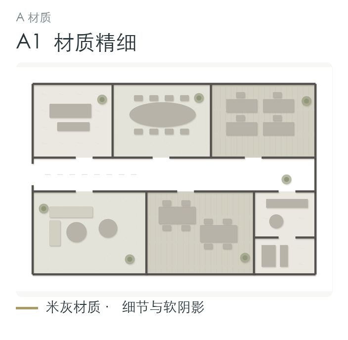
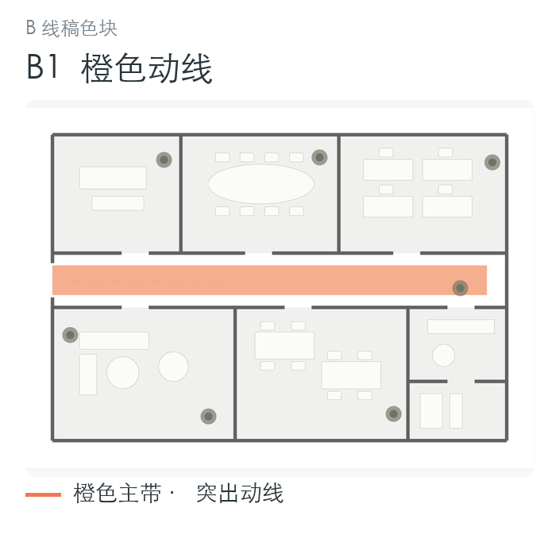
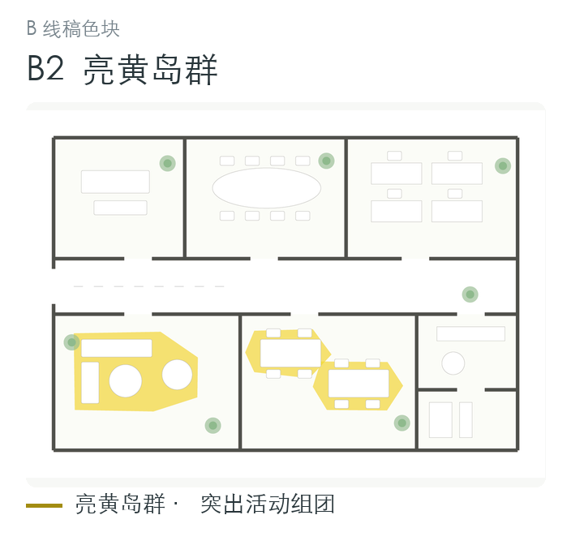
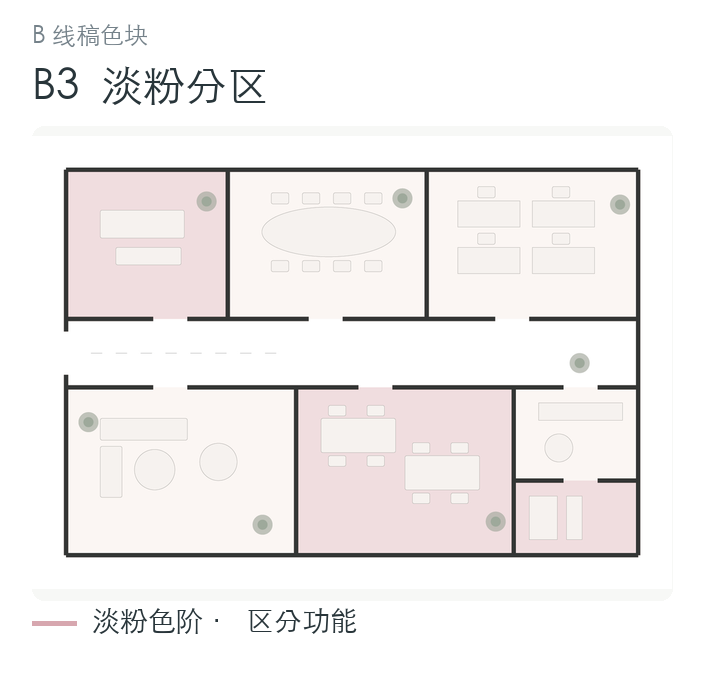
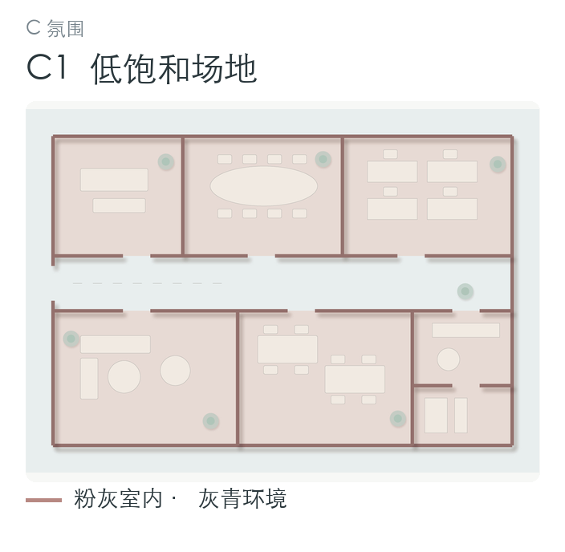
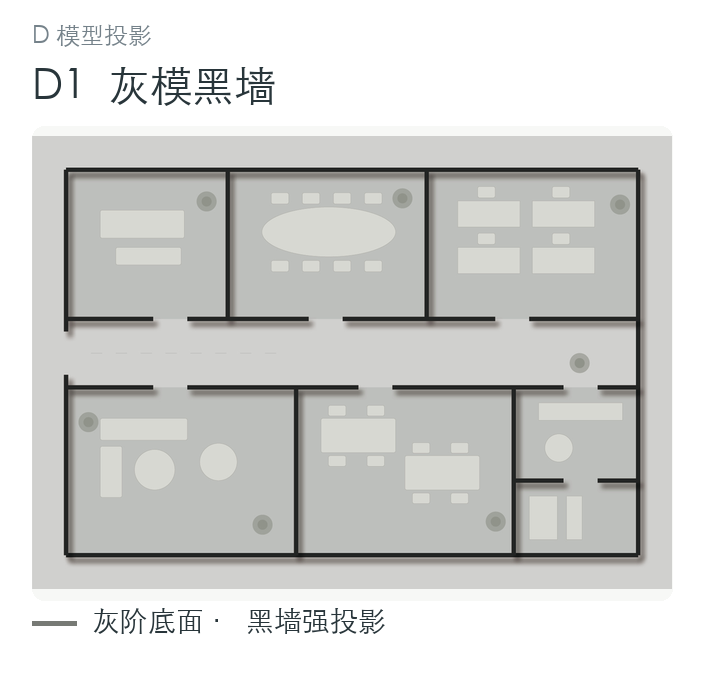
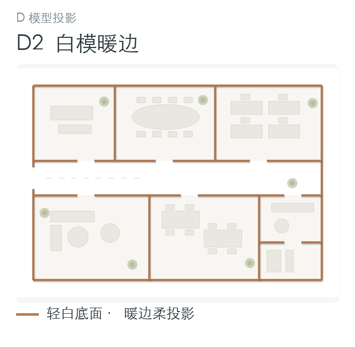
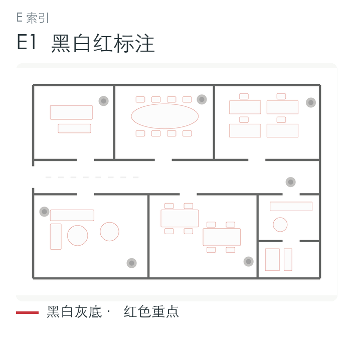

# 彩平风格目录

本目录按五类八款整理室内彩平表达，使用自造固定简图展示差异，公开包不包含真实客户案例或第三方参考截图。首轮直接显示 [预存速选图](../assets/style-picker/八款风格速选.png)，选定款式后再按需阅读本目录。

[样式参数表](../assets/style-presets.json) 给出归纳后的建议配色和效果参数，**并非从原图精确取色**。正式制作时结合项目材质说明、品牌要求及用户选择调整。JSON 中 `source_files` 相对于 `assets/` 目录；其余颜色字段为 `#RRGGBB`。`shadow` 为 `none / soft / long / strong`，`texture` 为 `material / none / paper`。这些是图面表达参数，不代表实际材料规格或三维灯光数据。

## A 材质精细型

### A1 材质精细

参考：

- **表达特征**：米灰地面、黑灰细线，木纹、石材和织物质感；家具细节较多，阴影克制；灰绿、土黄等色彩仅作局部点缀。空间名称按当前项目图纸处理。
- **适用**：住宅、精品接待及需要表达材质和软装的空间。
- **可迁移变量**：地面主色、木纹方向、纹理尺度、织物密度、家具明暗、阴影透明度、植物饱和度及软装点色。纹理不能吞没家具和门窗线，材料没有说明时用中性示意材质并标明待定。
- **限制**：简图中的家具和材料仅说明表达风格，不是用户新项目的配置依据。

## B 线稿色块图解型

三种子样式分别突出动线、活动组团和功能分区。不能只给同一画面换三种颜色，就声称完成了三种表达方法。

### B1 橙色动线

- **表达特征**：浅灰底、深灰墙、白色家具；橙色渐变带贯穿主通道，其他区域明显降级。
- **适用**：展厅、办公及需要强调入口和主要流线的平面。
- **可迁移变量**：通道强调色、色带透明度、次要区域灰度、墙线与家具线级差。色带必须沿实际通道边界，不能跨越墙体或改变通行关系；渐变属于可选表达。

### B2 亮黄岛群

- **表达特征**：白底建筑线稿，圆角不规则活动岛填亮黄；普通家具浅灰，植物及少量点色辅助；几乎没有写实纹理与厚重阴影。
- **适用**：阅览、共享、活动等确有组团结构的空间。
- **可迁移变量**：真实组团边界、黄色明度、线稿灰度、植物与人物点色。原平面不存在岛形或活动组团时，按实际区域呈现，不为套风格新增组团和家具。

### B3 淡粉分区

- **表达特征**：黑白建筑线稿，粉色深浅区分功能区域；局部灰色，少量重点用红色；场外信息以轻线表达，仅在源图已知条件下保留比例尺和指北符号。
- **适用**：公共文化、教育及概念汇报中的功能分区表达。
- **可迁移变量**：分区色阶、填色透明度、建筑与环境的线重、人物点色及功能标题。色域必须服从 PDF 及文字描述，不能凭家具形状推定未说明的功能。

## C 低饱和场地氛围型

### C1 低饱和场地

- **表达特征**：粉灰建筑与灰青室外环境、轻纹理底、树木及人物；投影方向统一，建筑在场地中斜置。
- **适用**：同时需要交代建筑、庭院和室外关系的首层或场地平面。
- **可迁移变量**：室内外两组低饱和配色、环境衰减、铺地纹理、植被密度和统一投影。斜置只可作为用户指定的编排角度，不应自动旋转源平面。源 PDF 不含场地时，保留干净底色，不编造周边建筑、道路或景观。
- **限制**：固定简图不提供真实环境尺寸、建筑高度或太阳方向；阴影只用于图面表达。

## D 模型投影型

两种样式可通过二维图层和阴影形成模型感，不因此声称制作了真实三维模型。

### D1 灰模黑墙

- **表达特征**：灰阶底面、厚黑剖切墙、浅灰家具；较长且柔化的统一投影产生强模型感；轴网和标高仅依据当前源图保留。
- **适用**：突出墙体关系、体量层次及灰阶概念汇报。
- **可迁移变量**：背景明度、剖切墙颜色、家具显隐、投影方向、长度和柔度。正式图面须削弱会遮挡门窗、墙线及空间编号的阴影。

### D2 白模暖边

- **表达特征**：白底、极浅灰家具与地面、暖铜橙色墙边、柔阴影；留白较多，文字保持清晰、克制。
- **适用**：住宅、公寓及轻量、干净的方案展示。
- **可迁移变量**：暖色边线、白底与地面的明度差、家具透明度、柔阴影。优先确保图纸可读；无需照搬参考中的手写字体、标志和外语文字。

## E 索引标注型

### E1 黑白红标注

- **表达特征**：黑白 CAD 线稿、灰色墙体，红色重点、家具线或圆形编号；重点在于图纸阅读和功能索引。
- **适用**：希望保留图纸清晰度，以编号和重点对象组织阅读的平面页；需要展示已确定家具选型时，可另加产品展示。
- **可迁移变量**：灰色墙体深浅、黑灰线重、红色强调范围、编号样式及文字级差。红色用于重点和编号，不能把所有线稿统一染红；真实 PDF 中红线若带有拆改、审阅或其他图纸含义，应保留并优先解释其含义，不得作为装饰任意抹除或改色。
- **版式边界**：产品实物图属于可选的选型表达。本技能正式页右侧仍为“编号—功能名称”，采用通用左图右表版式；仅在用户提供产品素材且要求选型展示时增加产品图，不以本例替代既定版式。
- **限制**：简图不提供具体产品型号；产品本色不是此样式必须增加的强调色。

## 预存选样与单款制作

1. 新项目首轮直接显示固定的八款简图及样式号，不按新 PDF 生成这些预览。默认一屏给出八个具体 ID，用户一次选择即可开始制作。
2. 只选了 B 或 D 父类时，才用 [B 类预存图](../assets/style-picker/B_线稿色块.png) 或 [D 类预存图](../assets/style-picker/D_模型投影.png) 细选；不要为此重新渲染。已有明确款式则直接沿用。
3. 选定后读取该款参考与实际 PDF，将表达参数适配到真实布局，直接制作这一个款式；不再插入“先做四款/八款项目 demo 再选”的环节。
4. 对不具备场地、岛群等条件的图纸，迁移配色和层次，不为套样式增造空间或室外信息。编号和功能表用本项目的清单，在 ID 中保持可编辑。
5. 只有用户明确要求当前 PDF 的多款对比，才进入同底图项目 demo；各稿共享几何、裁切、朝向、布置和编号。这个例外不改变默认选样机制。

## 简图的范围

简图是固定的虚构平面，表达材质、色阶、投影和索引的差异；不提供项目面积、家具配置或材料规格。正式制作使用当前 PDF 的真实布局和功能文字，保留朝向与几何，不复制简图房间。
